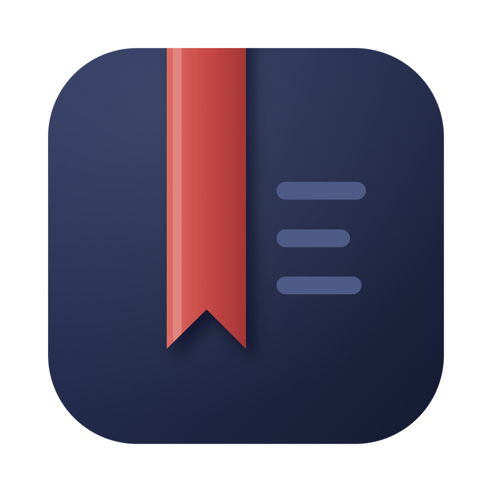
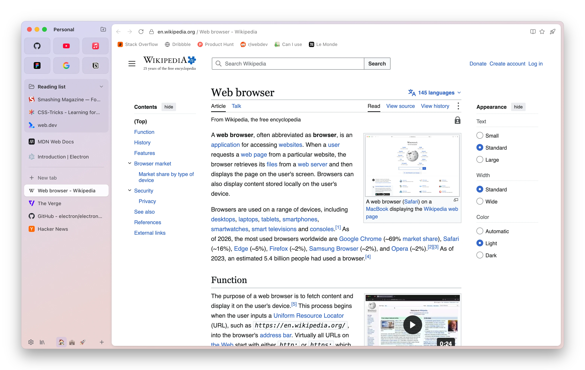

<p align="center">
  
</p>

<h1 align="center">Signet</h1>

<p align="center">
  A sidebar-first web browser for macOS, Linux and Windows, with a companion app for iOS and Android.
</p>

<p align="center">
  <a href="https://github.com/ItsKarmaOff/Signet/actions/workflows/ci.yml"></a>
  <a href="LICENSE"></a>
</p>

<p align="center">
  <b>English</b> · <a href="README.fr.md">Français</a>
</p>

<p align="center">
  
</p>

---

Signet puts your tabs in a vertical sidebar, groups them into spaces, and keeps the page itself as large as possible. The desktop app is built with Electron, React and TypeScript. The mobile app is built with React Native and Expo, and shares its data model with the desktop app.

The project is young and moving fast. Expect rough edges, and please [report them](https://github.com/ItsKarmaOff/Signet/issues).

## Features

Shortcuts below are the macOS defaults. On Linux and Windows, <kbd>⌘</kbd> becomes <kbd>Ctrl</kbd>. Every shortcut can be changed in Settings.

**Tabs and spaces**

- **Sidebar and spaces**: vertical tabs, favorites, pinned tabs, and daily tabs that archive themselves. One space per context, each with its own color or gradient (2 or 3 colors plus grain).
- **Command bar** (<kbd>⌘T</kbd>, <kbd>⌘L</kbd>): open tabs, history, archives, actions and search in one place.
- **Split view** (<kbd>⌃⇧=</kbd>): two or three pages side by side.
- **Peek** (<kbd>⇧</kbd> click): preview a link on top of the current page.
- **Little Signet** (<kbd>⌥⌘N</kbd>): a small window for a quick link, which you can pull back into the main window.
- **Tab previews** on hover, tab sleep for tabs you haven't used in a while, and undo for closing or archiving.
- **Live folders**: a sidebar folder that fills itself from an RSS or Atom feed, or from your GitHub pull requests.
- **Notes and Easels** (<kbd>⌃⌘N</kbd>): notes and free-form boards (text, drawings, images) that live in the sidebar like tabs.

**Browsing**

- **Built-in ad blocker** and **Chrome Web Store extensions**.
- **Passwords**: Signet's own vault, encrypted by the system keychain, or the password manager of your choice (Bitwarden, 1Password…).
- **Reader mode** (<kbd>⌥⌘R</kbd>) and in-place **page translation**.
- **Print** (<kbd>⌘P</kbd>), export to PDF, save the page, view source (<kbd>⌥⌘U</kbd>), spelling suggestions in the context menu.
- **Screenshots** (<kbd>⇧⌘2</kbd>): an area, the visible part or the full page, copied or saved.
- **Web apps**: install a site as an app, like Chrome does, with its own window and its own icon in the Dock, Launchpad and Spotlight.

**Customization**

- **Boosts**: per-site tweaks (custom CSS, dark mode, hiding elements).
- **Mods**: CSS that restyles Signet's own interface. If a mod breaks the interface, start with `--safe-mode`.
- **App icons**: eight icons to choose from.
- **Backup**: export and import your setup (settings, spaces, bookmarks, encrypted passwords…), part by part.
- **Interface in English and French.**

**For web developers**

- Built-in devtools, a developer mode for local pages (console error count, keep local pages out of history), responsive mode, and a JSON viewer.
- **Phone link**: pair your phone with a QR code, no account needed, and open your computer's `localhost` on the phone.

**Mobile app (iOS and Android)**

- Browser, command bar, tabs, spaces, library, settings, private tabs with a biometric lock, ad blocker, passwords, downloads (iOS) and site icons.
- On iOS, every browser has to use Apple's WebKit engine, so desktop features that depend on Chromium (extensions, for example) won't come to the phone as they are.

## Install

Download the file for your system from the [latest release](https://github.com/ItsKarmaOff/Signet/releases/latest):

| System                              | Intel / AMD (64-bit)           | ARM (64-bit)                                      |
| ----------------------------------- | ------------------------------ | ------------------------------------------------- |
| macOS                               | `Signet-X.Y.Z-x64.dmg`         | `Signet-X.Y.Z-arm64.dmg` (Apple Silicon: M1, M2…) |
| Windows                             | `Signet-X.Y.Z-x64-setup.exe`   | -                                                 |
| Linux, any distribution (AppImage)  | `Signet-X.Y.Z-x86_64.AppImage` | `Signet-X.Y.Z-arm64.AppImage`                     |
| Linux: Debian, Ubuntu, Mint (`deb`) | `Signet-X.Y.Z-amd64.deb`       | `Signet-X.Y.Z-arm64.deb`                          |
| Linux: Fedora, openSUSE (`rpm`)     | `Signet-X.Y.Z-x86_64.rpm`      | `Signet-X.Y.Z-aarch64.rpm`                        |
| Android                             | -                              | `Signet-X.Y.Z-android-arm64.apk`                  |

The apps are not signed with a paid certificate yet, so your system will warn you the first time:

- **macOS**: open the app once, close the warning, then go to **System Settings › Privacy & Security** and click **Open Anyway**.
- **Windows**: on the SmartScreen warning, click **More info › Run anyway**.
- **Android**: allow installs from unknown sources.

On Linux:

- **AppImage**: make it executable (`chmod +x Signet-*.AppImage`), then run it. It adds itself to the app menu and updates itself. If it doesn't start, install FUSE (on Ubuntu 24.04 and later: `sudo apt install libfuse2t64`).
- **deb**: `sudo apt install ./Signet-X.Y.Z-amd64.deb`. **rpm**: `sudo dnf install ./Signet-X.Y.Z-x86_64.rpm`. Signet then shows up in the app menu. When a new version is out, Signet tells you: install it the same way.

To run from source, see below.

## Compatibility

**Desktop**

| System     | Processor          | Package                | Tested      |
| ---------- | ------------------ | ---------------------- | ----------- |
| macOS      | Apple Silicon      | `.dmg`                 | ✅ macOS 27 |
| macOS      | Intel              | `.dmg`                 | ⚠️ Not yet  |
| Windows 11 | Intel / AMD 64-bit | `.exe` installer       | ⚠️ Not yet  |
| Linux      | Intel / AMD 64-bit | AppImage, `deb`, `rpm` | ⚠️ Not yet  |
| Linux      | ARM 64-bit         | AppImage, `deb`, `rpm` | ⚠️ Not yet  |

**Mobile**

| System  | Package                                                                          | Tested     |
| ------- | -------------------------------------------------------------------------------- | ---------- |
| iOS     | No App Store release yet: build it yourself ([app/mobile](app/mobile/README.md)) | ✅ iOS 27  |
| Android | `.apk` (ARM 64-bit)                                                              | ⚠️ Not yet |

"Not yet" means the app is built for that system and passes the automated tests (unit tests on Windows and Linux, end-to-end tests on Linux), but nobody has used it there yet. Other macOS and iOS versions haven't been tried either. If you run Signet on one of them, please [say how it went](https://github.com/ItsKarmaOff/Signet/issues).

## Run from source

You need [Node.js](https://nodejs.org/) 24 (the version CI uses) and npm.

```bash
git clone https://github.com/ItsKarmaOff/Signet.git
cd Signet
npm install
npm run dev        # desktop app with hot reload
```

If the app doesn't start because Electron's binary is missing (`node_modules/electron/path.txt` doesn't exist), install it:

```bash
node node_modules/electron/install.js
```

### Mobile

```bash
npm run mobile     # starts Expo and prints a QR code
```

Install **Expo Go** (SDK 58) on your phone and scan the QR code. Your phone and computer must be on the same Wi-Fi network. Building the native app, the iOS simulator, Android and known limits are covered in [app/mobile/README.md](app/mobile/README.md).

## Repository layout

This is an npm workspaces monorepo: one `npm install` at the root sets up all three packages.

```
app/desktop/       desktop app (Electron + React + TypeScript), macOS, Linux and Windows
app/mobile/        mobile app (React Native + Expo), iOS and Android
packages/shared/   platform-neutral TypeScript shared by desktop and mobile
docs/              architecture, development guide, specification
```

`app/desktop` and `app/mobile` import `packages/shared`, never the other way around. `packages/shared` can't import Electron, Node, the DOM or React Native: its `tsconfig` doesn't include those types, so a forbidden import fails the type check.

## Commands

Run them all from the repository root.

| Command                  | What it does                                                   |
| ------------------------ | -------------------------------------------------------------- |
| `npm run dev`            | Runs the desktop app with hot reload.                          |
| `npm run build`          | Builds the desktop app into `app/desktop/out`.                 |
| `npm start`              | Runs the built desktop app.                                    |
| `npm run typecheck`      | Type-checks desktop, shared and mobile.                        |
| `npm test`               | Unit tests (Vitest) for desktop and shared.                    |
| `npm run test:e2e`       | End-to-end tests (Playwright + Electron).                      |
| `npm run lint`           | ESLint on the whole repository.                                |
| `npm run format`         | Formats with Prettier (`format:check` only checks).            |
| `npm run i18n:check`     | Checks that English and French have the same translation keys. |
| `npm run icons`          | Regenerates the app icons.                                     |
| `npm run dist`           | Builds the macOS `.dmg` into `app/desktop/dist`.               |
| `npm run dist:linux`     | Builds the Linux AppImage.                                     |
| `npm run dist:win`       | Builds the Windows installer.                                  |
| `npm run mobile`         | Starts Expo for the mobile app.                                |
| `npm run mobile:ios`     | Opens the mobile app in the iOS simulator.                     |
| `npm run mobile:android` | Opens the mobile app on Android.                               |
| `npm run mobile:device`  | Builds and installs the mobile app on a plugged-in iPhone.     |

## Documentation

The in-depth docs are written in French for now.

- [docs/ARCHITECTURE.md](docs/ARCHITECTURE.md): map of the code, start here as a new contributor.
- [docs/DEVELOPMENT.md](docs/DEVELOPMENT.md): dev scripts, tests, `SIGNET_*` environment variables.
- [docs/SPEC.md](docs/SPEC.md): expected behavior, version by version.
- [docs/A-VERIFIER.md](docs/A-VERIFIER.md): what still has to be checked by hand.
- [app/mobile/README.md](app/mobile/README.md) and [packages/shared/README.md](packages/shared/README.md).

## Contributing

Contributions are welcome: bug reports, fixes, features, translations and docs. Read [CONTRIBUTING.md](CONTRIBUTING.md) before opening a pull request. To report a security issue, follow [SECURITY.md](SECURITY.md) instead of opening a public issue. Everyone taking part is expected to follow the [Code of Conduct](CODE_OF_CONDUCT.md).

## License

Signet is free software, released under the [GNU General Public License v3.0 or later](LICENSE).
