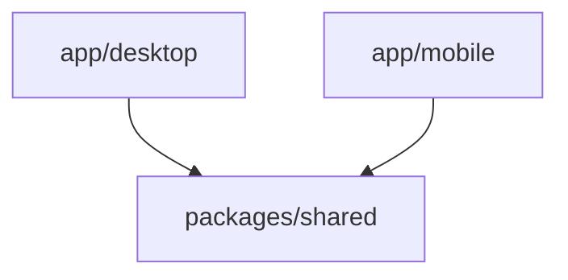
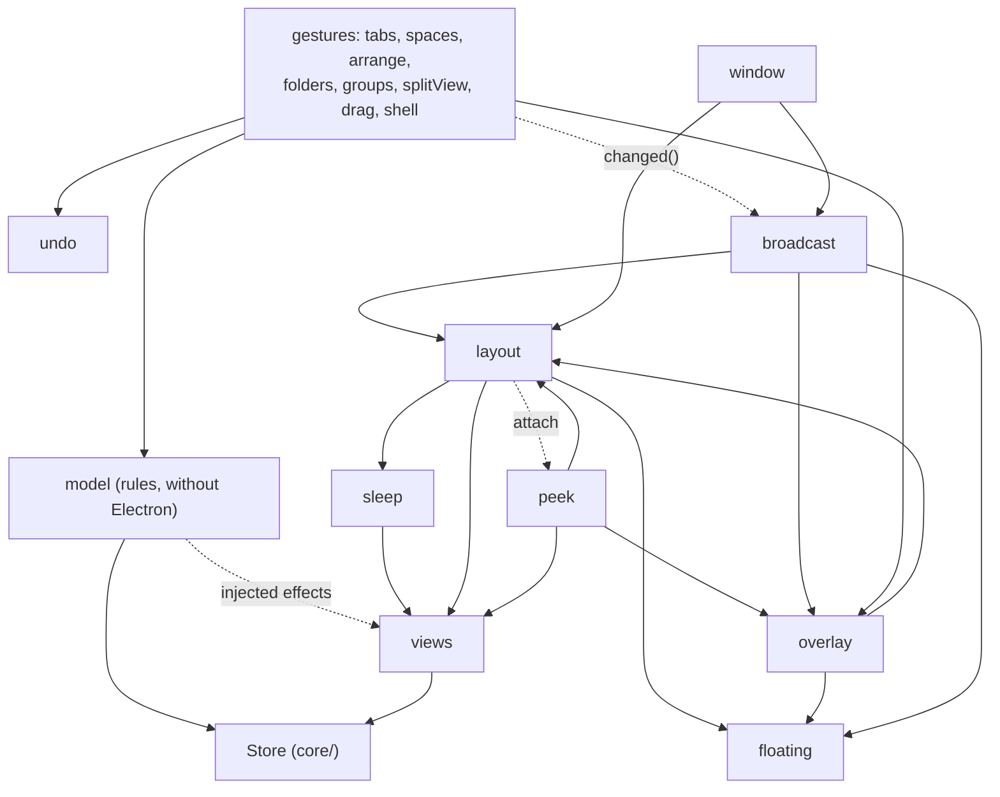
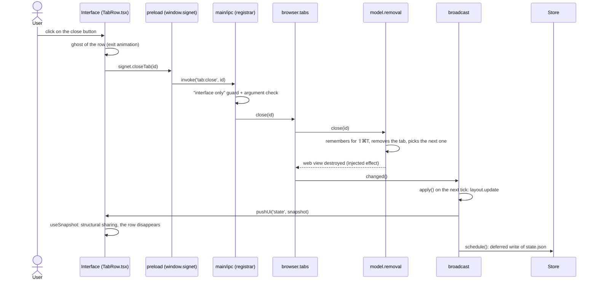

# Signet architecture

This document is the map of the code. Use it to find where something lives, and where to put yours.

- To run, test and debug: [DEVELOPMENT.md](DEVELOPMENT.md).
- For the expected behavior, version by version: [SPEC.md](SPEC.md).

## 1. Overview: the monorepo

The repo is an npm monorepo: a single `npm install` at the root, three "workspaces" (packages that live in the same repo).

| Folder            | Package name      | Role                                                                               |
| ----------------- | ----------------- | ---------------------------------------------------------------------------------- |
| `app/desktop`     | `@signet/desktop` | The Electron app (macOS, Linux, Windows). This is the real browser.                |
| `app/mobile`      | `@signet/mobile`  | The React Native / Expo app (iOS, Android). Foundations in place (see its README). |
| `packages/shared` | `@signet/shared`  | Platform-free TypeScript: data model, rules, URLs, languages.                      |

Who may import whom:



- `desktop` and `mobile` import `shared`.
- `shared` imports **nothing** platform-specific: no `electron`, no `node:*`, no DOM (`document`, `window`), no React Native. Its `tsconfig` has neither the DOM types nor the Node types: a forbidden import does not compile.
- `shared` never imports `desktop` or `mobile`. `desktop` and `mobile` do not import each other.

Simple rule: if a rule can serve both apps, it goes in `packages/shared` (see [its README](../packages/shared/README.md)).

Watch out, there are **two** folders named "shared" on the desktop side:

- `packages/shared` (`@signet/shared/…`): shared by desktop **and** mobile.
- `app/desktop/src/shared` (alias `@shared/…`): shared by the processes **of the desktop only** (IPC contract, shortcuts, test devices, notes). Mobile does not see it.

## 2. Desktop: the processes

Electron runs several processes. Signet uses three kinds:

```
app/desktop/src/
  main/       the main process (Node.js): it owns the windows, the tabs, the state and the disk
  preload/    small scripts that run in the pages, before them (the "bridge")
  renderer/   the React interface (sidebar, command bar, settings…), drawn in web pages
  shared/     types and contracts shared by these three kinds of code (alias @shared)
```

### The main process (`main/`)

This is the brain. It holds the state (`Store`), applies the rules, creates the windows and places each view. It talks to the interfaces over IPC (see §5).

### The interfaces are web pages in `WebContentsView`s

There is no "one React window". The interface is **a single React bundle** (`renderer/index.html`), loaded into several pages. Each page picks what it shows from the **URL hash** (`#overlay`, `#little`…), see §7.

The main process creates and places them itself:

- The **main window** (`BrowserWindow`) loads the empty route `''`: sidebar, panel bar, bookmarks bar.
- Each **web tab** is a `WebContentsView` placed by the main process on the window, at the spot computed by `browser/layout.ts`. So the React interface does not "contain" the pages: it only leaves a hole, and the main process puts the views there.
- The **floating surfaces** are also transparent `WebContentsView`s placed on top: `#overlay` (command bar, popovers, Peek), `#sidebar` (floating sidebar), `#toolbar` (compact mode bar), `#find`, `#toast`, `#preview` (hover preview), `#pip` (mini player). The `UiView` class (`browser/uiview.ts`) creates them and queues messages sent before the page is ready.
- The **separate windows** are `BrowserWindow`s: `#little` (Little Signet), `#private`, `#settings`, `#library`, `#webapp`, `#boost`, `#devtools`, `#quit`.

`core/urls.ts` (`loadRoute(wc, hash)`) loads the interface into a view: the Vite server in development, the `signetui://app/` scheme in production (served by `browser/uiprotocol.ts`).

### The preload scripts (`preload/`)

There are two kinds, and the difference is a security boundary.

**The interface preload** (`preload/index.ts`): trusted. It only runs in the app's interface pages. It builds `window.signet` (and `window.signetPip` for the mini player) from the IPC contract, with a loop, without any hand-written method.

**The page scripts**: **untrusted**, because they run in the tabs, so next to arbitrary web pages. The main process registers them on the tab sessions (`web/profiles.ts`, `registerPreloadScript`). They have access neither to `window.signet` nor to the interface channels:

| File                   | Role                                                                                                     |
| ---------------------- | -------------------------------------------------------------------------------------------------------- |
| `preload/identity.ts`  | Fills `window.chrome` like Chrome does (otherwise Google refuses the sign-in). Runs in the page's world. |
| `preload/swipe.ts`     | Two-finger swipe to go back or forward.                                                                  |
| `preload/passwords.ts` | Suggests accounts on sign-in fields, reports submitted credentials.                                      |
| `preload/notes.ts`     | Bridge for the Note and Easel pages (active only on their route).                                        |

The main process re-checks everything they send it: sender, tab, frame, address. Their channels are listed in `PAGE_IPC` (§5).

## 3. The main process: the folders

```
main/
  index.ts       app startup: single instance, schemes, creation of the Store and the Browser, IPC
  app/           the app itself: menu, language, appearance, platform, icon, quit, error log
  core/          persisted state (Store), history, atomic write, tree utilities, preload paths
  model/         the state rules (open, close, move, archive…), without Electron
  browser/       the Browser class and its parts: views, layout, broadcast, overlays, gestures
  windows/       the separate windows: Little Signet, private, mini player, settings, library
  web/           everything web: sessions, permissions, downloads, ad blocker, signet://
  features/      the features: backup, bookmarks, passwords, notes, reader, translation, extensions, import…
  devtools/      the built-in developer tools (pane, developer mode, responsive, JSON viewer)
  ipc/           the handlers for the interface calls, one file per domain
  dev/           development hooks: captures and checks driven by SIGNET_* variables
```

One line each:

- **`app/`**: `menu.ts` (menu and shortcuts), `i18n.ts` (main process language, `t()`), `appearance.ts` (theme, translucency), `platform.ts` (`IS_MAC`, `windowChrome()`), `quit.ts` (confirmation before quitting), `uilog.ts` (`interface.log` log).
- **`core/`**: `store.ts` (state persisted in `state.json`, deferred write), `history.ts` (history), `atomic.ts` (atomic write), `tree.ts` (tree: translated layer over `@signet/shared/tree`), `urls.ts` (preload paths, `loadRoute`, `isAppUrl`).
- **`model/`**: the rules, one class per topic (`Activation`, `Opening`, `Removal`, `Archive`, `Folders`, `Groups`, `Splits`, `Spaces`, `Lists`, `ClosedTabs`), brought together by `Model`. No Electron import: whatever needs it (destroying a view, generating an id) is **injected** by `ModelEnv` (`model/types.ts`). This is what makes these rules testable without launching the app.
- **`browser/`**: see §4.
- **`windows/`**: `little.ts`, `private.ts`, `pip.ts`, `settings.ts`, `library.ts`.
- **`web/`**: `profiles.ts` (one session per isolated space, page scripts), `permissions.ts`, `downloads.ts`, `adblock.ts`, `internal.ts` (`signet://` addresses), `guard.ts` (locks down the interface views), `identity.ts` (user agent), `favicons.ts`, `errorpage.ts`, `languages.ts`.
- **`features/`**: one file or subfolder per feature: `passwords/`, `notes/`, `importers/` (formats described in [FORMATS.md](../app/desktop/src/main/features/importers/FORMATS.md)), `extensions/`, `boost/`, `mods/`, `livefolders/`, `backup.ts`, `bookmarks.ts`, `capture.ts`, `reader.ts`, `translate.ts`, `pagetools.ts`, `webapps.ts`…
- **`devtools/`**: `devtools.ts` (pane), `devmode.ts` (developer mode), `develop.ts` ("Develop" menu, responsive), `jsonview.ts`.
- **`ipc/`**: see §5.
- **`dev/`**: development hooks (`capture.ts`, `seed.ts`, `probes.ts`), which drive the app for captures and checks. See [DEVELOPMENT.md](DEVELOPMENT.md).

## 4. `Browser`, the composition root

`browser/browser.ts` is the `Browser` class. It **contains no logic**: its constructor creates each part and gives it what it needs. It is the only place where you can see who depends on whom. Each part receives a small dependency object (`*Deps`) instead of the whole `Browser`, and keeps only what it uses.

Four accessors stay direct because all the code uses them: `browser.store`, `browser.history`, `browser.win` (the main window) and `browser.space` (the active space).

### The core

| Part (`Browser` field) | File                   | Role                                                                                                        |
| ---------------------- | ---------------------- | ----------------------------------------------------------------------------------------------------------- |
| `model`                | `model/`               | The state rules, without Electron.                                                                          |
| `views`                | `browser/views.ts`     | Lifecycle of the tabs' `WebContentsView`s: created on demand, destroyed on sleep or on close.               |
| `sleep`                | `browser/sleep.ts`     | Puts tabs hidden for a long time to sleep (the view is destroyed, the address stays).                       |
| `floating`             | `browser/floating.ts`  | Floating sidebar (revealed on hover over the left edge).                                                    |
| `layout`               | `browser/layout.ts`    | Computes the place of each view (cards, split view, dividers) and places it.                                |
| `undo`                 | `browser/undo.ts`      | "… · Undo" notices (archiving, closed group, deleted space).                                                |
| `overlay`              | `browser/overlay.ts`   | The `#overlay` view: command bar, popovers, capture, password.                                              |
| `peek`                 | `browser/peek.ts`      | Floating preview of a page, placed in the overlay; animation in `peekanim.ts`.                              |
| `broadcast`            | `browser/broadcast.ts` | `changed()`: batches changes, recomputes the layout, sends the state to the interfaces, schedules the save. |
| `window`               | `browser/window.ts`    | Creation of the main window, recovery after an interface crash, teardown.                                   |

The other fields (`little`, `privates`, `find`, `media`, `pip`, `passwords`, `notes`, `extensions`, `devtools`…) are the features from `windows/`, `features/`, `devtools/` and the neighboring files in `browser/` (`find.ts`, `media.ts`, `compact.ts`, `palette.ts`, `preview.ts`, `sitepanel.ts`, `sitecolor.ts`, `swipe.ts`).

### User gestures

Each gesture calls a `model` rule, then `changed()`. These classes contain only this "glue" between the model and Electron.

| Part (field) | File                        | Gestures                                                       |
| ------------ | --------------------------- | -------------------------------------------------------------- |
| `tabs`       | `browser/tab-actions.ts`    | Open, navigate, close, activate, reopen, archive today's tabs. |
| `spaces`     | `browser/space-actions.ts`  | Switch, create, configure, delete (undoable) a space.          |
| `arrange`    | `browser/arrange.ts`        | Move, pin, add to favorites, move up or down.                  |
| `folders`    | `browser/folder-actions.ts` | Sidebar folders.                                               |
| `groups`     | `browser/group-actions.ts`  | Tab groups.                                                    |
| `splitView`  | `browser/splitview.ts`      | Split view.                                                    |
| `drag`       | `browser/drag.ts`           | Drag a tab onto the page (drop zones).                         |
| `shell`      | `browser/shell.ts`          | Window look: sidebar, compact mode, tabs on top.               |

### Who depends on whom

The diagram shows the main dependencies of the core (an arrow = "uses"). The gestures, on the right, use the `model` and call `changed()` on `broadcast`.



Two dependencies are circular by nature (the overlay and the Peek know each other, the layout knows the overlay). They are resolved by an `attach(...)` call after construction, in `browser.ts`. The parts also pass small functions (`changed`, `apply`) rather than the `Broadcast` class, which does not exist yet when the first ones are created.

## 5. The state flow

The state lives **in the main process**. The interfaces only have a read-only copy.

1. **The `Store`** (`core/store.ts`) holds the persisted state (`state.json`): spaces, tabs, settings, favorites. Bookmarks and history have their own files. The write is deferred and atomic (`core/atomic.ts`).
2. **A model rule** changes `store.state` (for example `model.removal.close(tabId)`).
3. **`changed()`** (`broadcast.changed`) marks what needs redoing: layout, send, save. Calls in the same tick are batched (`setImmediate`); engine events (title, icon, loading) are batched over 32 ms (`soft`).
4. **`apply()`** runs the cycle: recomputes the layout (`layout.update`), then sends:
   - a **full snapshot** (`state`) when the structure has changed;
   - a **small message** (`state:patch`, only the touched tab fields) when only the title, the icon or the loading state changed and nothing derived has moved.
     It also sends to the floating surfaces that are visible, to the side windows (`satellites`), and rebuilds the menu if its checkmarks changed.
5. **The save** is scheduled by `store.schedule(...)`: fast (500 ms) for a real change, 5 s for a tab title or icon, 60 s if only those changed in a burst (`lazy`).
6. On the interface side, **`useSnapshot()`** (`renderer/src/lib/util.ts`) reads the initial state (`getState`), then applies the `state` and `state:patch` messages. It keeps unchanged objects as they are (**structural sharing**: `share(prev, next)`), so that React only redraws what changed.
7. **Optimism** (`lib/optimistic.ts`): on a click on a tab or a space, the interface shows the selection right away, without waiting for the main process state. The choice is dropped at the first update received after the main process answers, or 400 ms later if the main process refused.

Example: the user clicks the close button of one of today's tabs.



For a pinned tab, `model.removal.close` does not remove the tab: it destroys its view and resets it to its original address. The close button becomes "Unload".

## 6. IPC: a typed contract

IPC = inter-process communication. A call from the interface to the main process goes through a **channel** (a string like `'tab:close'`). Everything is described in one place.

| Item                                     | Role                                                                                                               |
| ---------------------------------------- | ------------------------------------------------------------------------------------------------------------------ |
| `app/desktop/src/shared/types/api.ts`    | `SignetApi`: the list of `window.signet` methods, with their types.                                                |
| `app/desktop/src/shared/ipc/contract.ts` | `IPC`: for each `SignetApi` method, its channel, its kind and the guards for its arguments.                        |
| `app/desktop/src/shared/ipc/validate.ts` | The guards (`str()`, `num()`, `opt(...)`, `lit(...)`, `obj(...)`…) and the compound types (`dropTarget`, `rect`…). |
| `app/desktop/src/preload/index.ts`       | Builds `window.signet` by looping over `IPC`.                                                                      |
| `app/desktop/src/main/ipc/registrar.ts`  | `createRegistrar`: registers the handlers, applies the guard and the validation.                                   |
| `app/desktop/src/main/ipc/<domain>.ts`   | The handlers, one file per domain (`tabs`, `spaces`, `sidebar`, `overlay`, `settings`, `library`…).                |
| `app/desktop/src/main/ipc/push.ts`       | `pushUi(wc, channel, ...args)`: send from the main process to an interface, typed by `UiEventMap`.                 |
| `app/desktop/src/main/ipc/page.ts`       | The channels of the **web pages** (untrusted), kept apart.                                                         |

There are two kinds of entry in `IPC`:

- `invoke('channel', [guards])`: the interface calls, the main process answers (a promise). This is a `SignetApi` method that returns a `Promise`.
- `event('channel')`: the main process pushes a message, the interface subscribes (`onX(cb)` returns an unsubscribe function).

The registrar does three things before calling a handler:

1. **"Interface only" guard**: the sender must be an app interface page (`fromUi`), and **not** a tab. A web page, even one that shows an app note, is refused ("IPC call refused").
2. **Argument validation** from the contract guards. A malformed call is refused with an error (or an `onInvalid` fallback value, for the rare calls that need one). In development, a warning is written once per channel.
3. **Uniqueness**: a channel registered twice throws an error.

### Web page channels

The page scripts (`preload/swipe.ts`, `passwords.ts`, `notes.ts`) call the main process from tabs, so they do **not** go through this registrar. Their channels are listed in `PAGE_IPC` (`contract.ts`) and registered by hand: `ipc/page.ts` for swipe and forms, `features/passwords/passwords.ts` and `features/notes/notes.ts` for their own. Each one checks its sender itself. A test (`ipc/contract.test.ts`) makes sure no channel is shared between the interface and the web pages.

### Recipe: add an IPC method

Example: a `foo(id)` method that does something in the main process.

1. **Declare the method** in `SignetApi`, in `app/desktop/src/shared/types/api.ts`: `foo(id: string): Promise<void>`. A pushed event is `onFooChanged(cb: (payload: Foo) => void): () => void`.
2. **Add the entry to `IPC`**, in `app/desktop/src/shared/ipc/contract.ts`: `foo: invoke('foo:do', [str()])`, or `onFooChanged: event('foo:changed')` for an event. If the argument type is new, write its guard in `validate.ts`. TypeScript rejects an `IPC` that does not match `SignetApi`.
3. **Write the handler** in `app/desktop/src/main/ipc/<domain>.ts`: `handle('foo', (ctx, id) => b.foo.doIt(id))`. The argument and result types come from `SignetApi`.
4. **For a pushed message**, on the main side: `pushUi(wc, 'foo:changed', payload)`. The channel and the payload type are checked at compile time.
5. **The preload needs no change**: it builds itself from `IPC`. On the interface side, call `window.signet.foo(id)` or `window.signet.onFooChanged(cb)`.

`npm test` checks the contract: each `SignetApi` method has an entry (and vice versa), channels are unique, and each contract call has **exactly one** registered handler (`ipc/contract.test.ts`, `ipc/ipc.test.ts`).

## 7. The interface (`renderer/src/`)

A single React bundle, split by domain:

```
renderer/src/
  main.tsx       entry point: picks the view from the hash, loads the language, mounts React
  App.tsx        the main window (and its floating variants: FloatingSidebar, FloatingToolbar)
  sidebar/       sidebar: space list, space strip, space preview
  toolbar/       panel bar, bookmarks bar, extension buttons
  tabs/          tab rows, top row, drop zones, dividers, hover preview, groups
  overlay/       everything that floats: command bar, popovers, Peek, find, capture, notices, Boost
  settings/      the Settings window, one section per file
  notes/         Note and Easel pages (HTML sanitized in notesHtml.ts)
  windows/       the "window" views: Little Signet, private, mini player, library, site panel, apps
  devtools/      the developer tools pane and the responsive mode
  ui/            small shared components: Favicon, EmojiPicker, InlineConfirm, MediaCard
  lib/           screenless utilities: useSnapshot, optimistic, flip, spring, useExit, useSpaceSwipe
  styles/        the stylesheets
```

**Hash routing.** `main.tsx` reads `location.hash` and picks the view: `''` → main window, `#overlay`, `#little`, `#find`, `#sidebar`, `#toolbar`, `#settings`, `#library`, `#pip`, `#private`, `#preview`, `#webapp`, `#devtools`, `#boost`, `#quit`, `#toast`; `#note/<id>` and `#easel/<id>` for documents. It also adds a `route-<name>` class on `<html>`, which sets the backgrounds in CSS. The less common routes are chunks loaded on demand (`import()`): each window loads only its own. A `Recovery` component wraps the view and logs render errors.

**Styles.** `styles/index.css` imports the stylesheets by domain (`tokens.css`, `base.css`, `sidebar.css`, `palette.css`…). **The order of the `@import`s matters**: it reproduces the rule order of the old single stylesheet, and the cascade depends on it (at equal specificity, the last rule wins). Do not reorder, and do not move a rule from one file to another, without checking the overrides. To add a stylesheet, add its `@import` at the right place in `index.css`.

**Languages in the interface.** `main.tsx` loads the `ui` catalog for the main process language (English is bundled, French is loaded on demand), then mounts an `I18nextProvider`. Components call `useTranslation()`.

## 8. Languages (i18n)

The texts are in JSON catalogs, shared with mobile:

```
packages/shared/src/locales/
  en/  main.json  ui.json  mobile.json
  fr/  main.json  ui.json  mobile.json
```

- `main.json`: the main process (menus, dialogs, command bar).
- `ui.json`: the desktop React interface.
- `mobile.json`: the mobile app.

English is the reference; a key missing in French falls back to English. `packages/shared/src/i18n.ts` creates the instance (`createI18n`); the main process uses it through `main/app/i18n.ts` (`t()`).

`npm run i18n:check` checks that `en` and `fr` have the same keys and the same `{{…}}` variables, and that no visible text is hard-coded in the desktop interface or in `app/mobile/src` and `app/mobile/app`. It runs in CI.

## 9. Tests

The commands are in [DEVELOPMENT.md](DEVELOPMENT.md). Here is where each kind of test lives.

| Kind                    | Where                                                                     | What it checks                                                              |
| ----------------------- | ------------------------------------------------------------------------- | --------------------------------------------------------------------------- |
| Shared package unit     | `packages/shared/src/*.test.ts`                                           | URLs, tree, split view, feeds, routes, tab reducer, i18n.                   |
| Desktop unit            | next to the code: `app/desktop/src/**/*.test.ts(x)`                       | `model/` rules, `core/`, `web/`, `features/`, interface (`lib/`, `tabs/`…). |
| IPC contract            | `main/ipc/contract.test.ts`, `ipc.test.ts`, `shared/ipc/validate.test.ts` | `SignetApi` and `IPC` consistency, one handler per channel, guard, guards.  |
| End to end (Playwright) | `app/desktop/tests/e2e/`                                                  | The real app: tabs, organization, persistence, surfaces.                    |

Unit tests sit **next to** the tested file (`foo.ts` and `foo.test.ts`). `model/` is tested without Electron; for the rest, `electron` is mocked.

## 10. Where do I put…?

| I want to add…                               | Where                                                                                                                                                                                                                                                                                                  |
| -------------------------------------------- | ------------------------------------------------------------------------------------------------------------------------------------------------------------------------------------------------------------------------------------------------------------------------------------------------------ |
| A setting                                    | Its type in `packages/shared/src/types/settings.ts`; its default value in `core/store.ts`; its section in `renderer/src/settings/`; its texts in `ui.json` (en and fr).                                                                                                                                |
| A sidebar feature                            | Rule in `main/model/` (with its test), gesture in the matching `*-actions.ts` class in `main/browser/`, IPC call (§6), component in `renderer/src/sidebar/` or `tabs/`.                                                                                                                                |
| A rule on tabs, spaces, folders              | `main/model/` (without Electron, with a test). If mobile can reuse it: `packages/shared/src/` (see `tree.ts`, `model.ts`, `tab-list.ts`).                                                                                                                                                              |
| A new window or surface                      | If it floats in the window: a `UiView('#name')` in `main/browser/`. If it is a separate window: a class in `main/windows/`. In both cases: a route in `ROUTES` and `LAZY`/`STATIC` in `main.tsx`, a component in `renderer/src/windows/` or `overlay/`, a stylesheet in `styles/` (and its `@import`). |
| An interface IPC channel                     | The recipe in §6.                                                                                                                                                                                                                                                                                      |
| A page script channel (untrusted)            | The script in `preload/` (to declare in `electron.vite.config.ts`, `preload` entry), its path in `core/urls.ts`, its registration in `web/profiles.ts`, the channel in `PAGE_IPC` (`contract.ts`) and a handler that **checks the sender** in the main process.                                        |
| A web feature (extension, import, page tool) | `main/features/<name>`, created in `Browser` (`browser.ts`), called by a handler in `main/ipc/`.                                                                                                                                                                                                       |
| A visible text                               | A key in `locales/{en,fr}/<main\|ui\|mobile>.json`, then `npm run i18n:check`.                                                                                                                                                                                                                         |
| Code that mobile can reuse                   | `packages/shared/src/<module>.ts` and its test, without any platform import (see its README).                                                                                                                                                                                                          |
| A shared data type                           | `packages/shared/src/types/`; a type used only by the desktop (IPC, windows, extensions): `app/desktop/src/shared/types/`.                                                                                                                                                                             |
| A mobile screen                              | a thin file in `app/mobile/app/` and the screen in `app/mobile/src/features/<feature>/` (see the [mobile README](../app/mobile/README.md)).                                                                                                                                                            |
