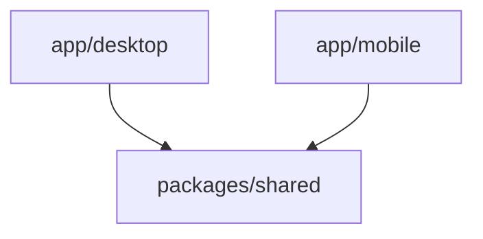
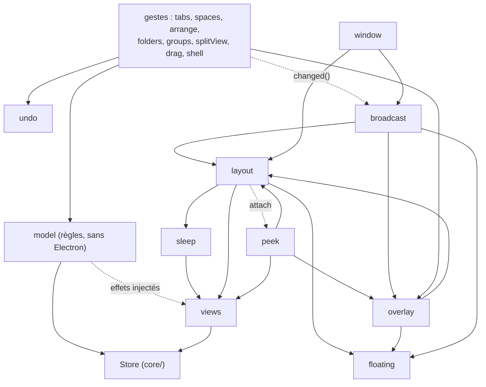
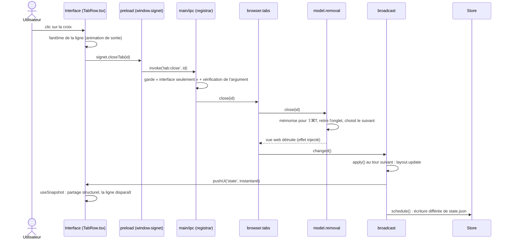

# Architecture de Signet

Ce document est la carte du code. Il sert à trouver où se trouve une chose, et où mettre la nôtre.

- Pour lancer, tester et déboguer : [DEVELOPMENT.md](DEVELOPMENT.md).
- Pour le comportement attendu, version par version : [SPEC.md](SPEC.md).

## 1. Vue d'ensemble : le monorepo

Le dépôt est un monorepo npm : un seul `npm install` à la racine, trois « workspaces » (des paquets qui vivent dans le même dépôt).

| Dossier           | Nom du paquet     | Rôle                                                                           |
| ----------------- | ----------------- | ------------------------------------------------------------------------------ |
| `app/desktop`     | `@signet/desktop` | L'app Electron (macOS, Linux, Windows). C'est le vrai navigateur.              |
| `app/mobile`      | `@signet/mobile`  | L'app React Native / Expo (iOS, Android). Fondations posées (voir son README). |
| `packages/shared` | `@signet/shared`  | Du TypeScript sans plateforme : modèle de données, règles, URL, langues.       |

Qui a le droit d'importer qui :



- `desktop` et `mobile` importent `shared`.
- `shared` n'importe **rien** de propre à une plateforme : ni `electron`, ni `node:*`, ni le DOM (`document`, `window`), ni React Native. Son `tsconfig` n'a ni les types DOM ni les types Node : un import interdit ne compile pas.
- `shared` n'importe jamais `desktop` ni `mobile`. `desktop` et `mobile` ne s'importent pas entre eux.

Règle simple : si une règle peut servir aux deux apps, elle va dans `packages/shared` (voir [son README](../packages/shared/README.md)).

Attention, il existe **deux** dossiers nommés « shared » côté bureau :

- `packages/shared` (`@signet/shared/…`) : commun au bureau **et** au mobile.
- `app/desktop/src/shared` (alias `@shared/…`) : commun aux processus **du bureau seulement** (contrat IPC, raccourcis, appareils de test, notes). Le mobile ne le voit pas.

## 2. Le bureau : les processus

Electron fait tourner plusieurs processus. Signet en utilise trois sortes :

```
app/desktop/src/
  main/       le processus principal (Node.js) : il possède les fenêtres, les onglets, l'état et le disque
  preload/    des petits scripts qui s'exécutent dans les pages, avant elles (le « pont »)
  renderer/   l'interface React (barre latérale, barre de commande, réglages…), dessinée dans des pages web
  shared/     types et contrats communs à ces trois sortes de code (alias @shared)
```

### Le processus principal (`main/`)

C'est le cerveau. Il tient l'état (`Store`), applique les règles, crée les fenêtres et place chaque vue. Il parle aux interfaces par IPC (voir §5).

### Les interfaces sont des pages web dans des `WebContentsView`

Il n'y a pas « une fenêtre React ». L'interface est **un seul bundle React** (`renderer/index.html`), chargé dans plusieurs pages. Chaque page choisit ce qu'elle affiche d'après le **hash de l'URL** (`#overlay`, `#little`…), voir §7.

Le main les crée et les place lui-même :

- La **fenêtre principale** (`BrowserWindow`) charge la route vide `''` : barre latérale, barre de panneau, barre de signets.
- Chaque **onglet web** est une `WebContentsView` posée par le main sur la fenêtre, à l'endroit calculé par `browser/layout.ts`. L'interface React ne « contient » donc pas les pages : elle ne fait que laisser un trou, et le main y pose les vues.
- Les **surfaces flottantes** sont aussi des `WebContentsView` transparentes posées par-dessus : `#overlay` (barre de commande, popovers, Peek), `#sidebar` (barre latérale flottante), `#toolbar` (barre du mode compact), `#find`, `#toast`, `#preview` (aperçu au survol), `#pip` (mini-lecteur). La classe `UiView` (`browser/uiview.ts`) les crée et met en file les envois faits avant que la page soit prête.
- Les **fenêtres à part** sont des `BrowserWindow` : `#little` (Little Signet), `#private`, `#settings`, `#library`, `#webapp`, `#boost`, `#devtools`, `#quit`.

`core/urls.ts` (`loadRoute(wc, hash)`) charge l'interface dans une vue : le serveur Vite en développement, le schéma `signetui://app/` en production (servi par `browser/uiprotocol.ts`).

### Les scripts de préchargement (`preload/`)

Il y en a de deux natures, et la différence est une frontière de sécurité.

**Le preload de l'interface** (`preload/index.ts`) : fiable. Il ne s'exécute que dans les pages d'interface de l'app. Il construit `window.signet` (et `window.signetPip` pour le mini-lecteur) d'après le contrat IPC, avec une boucle, sans méthode écrite à la main.

**Les scripts de page** : **non fiables**, car ils tournent dans les onglets, donc à côté de pages web quelconques. Le main les enregistre sur les sessions des onglets (`web/profiles.ts`, `registerPreloadScript`). Ils n'ont accès ni à `window.signet` ni aux canaux de l'interface :

| Fichier                | Rôle                                                                                                      |
| ---------------------- | --------------------------------------------------------------------------------------------------------- |
| `preload/identity.ts`  | Remplit `window.chrome` comme Chrome (sinon Google refuse la connexion). Tourne dans le monde de la page. |
| `preload/swipe.ts`     | Glisser à deux doigts pour revenir en arrière ou avancer.                                                 |
| `preload/passwords.ts` | Propose les comptes sur les champs de connexion, signale les identifiants envoyés.                        |
| `preload/notes.ts`     | Pont des pages Note et Easel (actif seulement sur leur route).                                            |

Le main revérifie tout ce qu'ils lui envoient : émetteur, onglet, cadre, adresse. Leurs canaux sont listés dans `PAGE_IPC` (§5).

## 3. Le processus principal : les dossiers

```
main/
  index.ts       démarrage de l'app : instance unique, schémas, création du Store et du Browser, IPC
  app/           l'app elle-même : menu, langue, apparence, plateforme, icône, quitter, journal d'erreurs
  core/          état persisté (Store), historique, écriture atomique, utilitaires d'arbre, chemins des preloads
  model/         les règles de l'état (ouvrir, fermer, déplacer, archiver…), sans Electron
  browser/       la classe Browser et ses parties : vues, disposition, diffusion, surimpressions, gestes
  windows/       les fenêtres à part : Little Signet, privée, mini-lecteur, réglages, bibliothèque
  web/           tout ce qui touche au web : sessions, permissions, téléchargements, bloqueur de pubs, signet://
  features/      les fonctions : sauvegarde, signets, mots de passe, notes, lecture, traduction, extensions, import…
  devtools/      les outils de développement intégrés (volet, mode développeur, responsive, visionneuse JSON)
  ipc/           les gestionnaires des appels de l'interface, un fichier par domaine
  dev/           crochets de développement : captures et vérifications pilotées par variables SIGNET_*
```

En une ligne chacun :

- **`app/`** : `menu.ts` (menu et raccourcis), `i18n.ts` (langue du main, `t()`), `appearance.ts` (thème, translucidité), `platform.ts` (`IS_MAC`, `windowChrome()`), `quit.ts` (confirmation avant de quitter), `uilog.ts` (journal `interface.log`).
- **`core/`** : `store.ts` (état persisté dans `state.json`, écriture différée), `history.ts` (historique), `atomic.ts` (écriture atomique), `tree.ts` (arbre : surcouche traduite de `@signet/shared/tree`), `urls.ts` (chemins des preloads, `loadRoute`, `isAppUrl`).
- **`model/`** : les règles, une classe par sujet (`Activation`, `Opening`, `Removal`, `Archive`, `Folders`, `Groups`, `Splits`, `Spaces`, `Lists`, `ClosedTabs`), réunies par `Model`. Aucun import d'Electron : ce qui en a besoin (détruire une vue, générer un id) est **injecté** par `ModelEnv` (`model/types.ts`). C'est ce qui rend ces règles testables sans lancer l'app.
- **`browser/`** : voir §4.
- **`windows/`** : `little.ts`, `private.ts`, `pip.ts`, `settings.ts`, `library.ts`.
- **`web/`** : `profiles.ts` (une session par espace isolé, scripts de page), `permissions.ts`, `downloads.ts`, `adblock.ts`, `internal.ts` (adresses `signet://`), `guard.ts` (verrouille les vues d'interface), `identity.ts` (user agent), `favicons.ts`, `errorpage.ts`, `languages.ts`.
- **`features/`** : un fichier ou un sous-dossier par fonction : `passwords/`, `notes/`, `importers/` (formats décrits dans [FORMATS.md](../app/desktop/src/main/features/importers/FORMATS.md)), `extensions/`, `boost/`, `mods/`, `livefolders/`, `backup.ts`, `bookmarks.ts`, `capture.ts`, `reader.ts`, `translate.ts`, `pagetools.ts`, `webapps.ts`…
- **`devtools/`** : `devtools.ts` (volet), `devmode.ts` (mode développeur), `develop.ts` (menu Développement, responsive), `jsonview.ts`.
- **`ipc/`** : voir §5.
- **`dev/`** : crochets de développement (`capture.ts`, `seed.ts`, `probes.ts`), qui pilotent l'app pour les captures et les vérifications. Voir [DEVELOPMENT.md](DEVELOPMENT.md).

## 4. `Browser`, la racine de composition

`browser/browser.ts` est la classe `Browser`. Elle **ne contient pas de logique** : son constructeur crée chaque partie et lui donne ce dont elle a besoin. C'est le seul endroit où l'on voit qui dépend de qui. Chaque partie reçoit un petit objet de dépendances (`*Deps`) au lieu de tout le `Browser`, et ne garde que ce qu'elle utilise.

Quatre accès restent directs parce que tout le code s'en sert : `browser.store`, `browser.history`, `browser.win` (la fenêtre principale) et `browser.space` (l'espace actif).

### Le noyau

| Partie (champ de `Browser`) | Fichier                | Rôle                                                                                                                    |
| --------------------------- | ---------------------- | ----------------------------------------------------------------------------------------------------------------------- |
| `model`                     | `model/`               | Les règles de l'état, sans Electron.                                                                                    |
| `views`                     | `browser/views.ts`     | Cycle de vie des `WebContentsView` des onglets : créées à la demande, détruites à la veille ou à la fermeture.          |
| `sleep`                     | `browser/sleep.ts`     | Met en veille les onglets masqués depuis longtemps (la vue est détruite, l'adresse reste).                              |
| `floating`                  | `browser/floating.ts`  | Barre latérale flottante (révélée au survol du bord gauche).                                                            |
| `layout`                    | `browser/layout.ts`    | Calcule la place de chaque vue (cartes, vue partagée, séparateurs) et la pose.                                          |
| `undo`                      | `browser/undo.ts`      | Annonces « … · Annuler » (archivage, groupe fermé, espace supprimé).                                                    |
| `overlay`                   | `browser/overlay.ts`   | La vue `#overlay` : barre de commande, popovers, capture, mot de passe.                                                 |
| `peek`                      | `browser/peek.ts`      | Aperçu flottant d'une page, posé dans l'overlay ; animation dans `peekanim.ts`.                                         |
| `broadcast`                 | `browser/broadcast.ts` | `changed()` : regroupe les changements, recalcule la disposition, envoie l'état aux interfaces, planifie la sauvegarde. |
| `window`                    | `browser/window.ts`    | Création de la fenêtre principale, reprise après plantage de l'interface, démontage.                                    |

Les autres champs (`little`, `privates`, `find`, `media`, `pip`, `passwords`, `notes`, `extensions`, `devtools`…) sont les fonctions de `windows/`, `features/`, `devtools/` et des fichiers voisins de `browser/` (`find.ts`, `media.ts`, `compact.ts`, `palette.ts`, `preview.ts`, `sitepanel.ts`, `sitecolor.ts`, `swipe.ts`).

### Les gestes de l'utilisateur

Chaque geste appelle une règle du `model`, puis `changed()`. Ces classes ne contiennent que ce « colle » entre le modèle et Electron.

| Partie (champ) | Fichier                     | Gestes                                                                    |
| -------------- | --------------------------- | ------------------------------------------------------------------------- |
| `tabs`         | `browser/tab-actions.ts`    | Ouvrir, naviguer, fermer, activer, rouvrir, archiver les onglets du jour. |
| `spaces`       | `browser/space-actions.ts`  | Changer, créer, régler, supprimer (annulable) un espace.                  |
| `arrange`      | `browser/arrange.ts`        | Déplacer, épingler, mettre en favori, monter ou descendre.                |
| `folders`      | `browser/folder-actions.ts` | Dossiers de la barre latérale.                                            |
| `groups`       | `browser/group-actions.ts`  | Groupes d'onglets.                                                        |
| `splitView`    | `browser/splitview.ts`      | Vue partagée.                                                             |
| `drag`         | `browser/drag.ts`           | Glisser un onglet sur la page (zones de dépôt).                           |
| `shell`        | `browser/shell.ts`          | Aspect de la fenêtre : barre latérale, mode compact, onglets en haut.     |

### Qui dépend de qui

Le schéma montre les dépendances principales du noyau (une flèche = « utilise »). Les gestes, à droite, utilisent le `model` et appellent `changed()` de `broadcast`.



Deux dépendances sont circulaires par nature (l'overlay et le Peek se connaissent, la disposition connaît l'overlay). Elles sont résolues par un appel `attach(...)` après la construction, dans `browser.ts`. Les parties passent aussi des petites fonctions (`changed`, `apply`) plutôt que la classe `Broadcast`, qui n'existe pas encore quand les premières sont créées.

## 5. Le flux de l'état

L'état vit **dans le main**. Les interfaces n'en ont qu'une copie, en lecture.

1. **Le `Store`** (`core/store.ts`) tient l'état persisté (`state.json`) : espaces, onglets, réglages, favoris. Les signets et l'historique ont leurs propres fichiers. L'écriture est différée et atomique (`core/atomic.ts`).
2. **Une règle du modèle** modifie `store.state` (par exemple `model.removal.close(tabId)`).
3. **`changed()`** (`broadcast.changed`) marque ce qui est à refaire : disposition, envoi, sauvegarde. Les appels du même tour sont regroupés (`setImmediate`) ; les événements du moteur (titre, icône, chargement) le sont sur 32 ms (`soft`).
4. **`apply()`** exécute le cycle : recalcule la disposition (`layout.update`), puis envoie :
   - un **instantané complet** (`state`) quand la structure a changé ;
   - un **petit message** (`state:patch`, seulement les champs d'onglets touchés) quand seuls le titre, l'icône ou le chargement ont changé et que rien de dérivé n'a bougé.
     Il envoie aussi aux surfaces flottantes qui sont visibles, aux fenêtres annexes (`satellites`), et reconstruit le menu si ses coches ont changé.
5. **La sauvegarde** est planifiée par `store.schedule(...)` : vite (500 ms) pour un vrai changement, 5 s pour un titre ou une icône d'onglet, 60 s si seuls ceux-là ont changé en rafale (`lazy`).
6. Côté interface, **`useSnapshot()`** (`renderer/src/lib/util.ts`) lit l'état initial (`getState`), puis applique les messages `state` et `state:patch`. Il garde les objets inchangés tels quels (**partage structurel** : `share(prev, next)`), pour que React ne redessine que ce qui a changé.
7. **L'optimisme** (`lib/optimistic.ts`) : au clic sur un onglet ou un espace, l'interface affiche la sélection tout de suite, sans attendre l'état du main. Le choix tombe à la première mise à jour reçue après la réponse du main, ou 400 ms après si le main a refusé.

Exemple : l'utilisateur clique sur la croix d'un onglet du jour.



Pour un onglet épinglé, `model.removal.close` ne retire pas l'onglet : il détruit sa vue et le remet sur son adresse d'origine. La croix devient « Décharger ».

## 6. L'IPC : un contrat typé

IPC = communication entre processus. Un appel de l'interface vers le main passe par un **canal** (une chaîne comme `'tab:close'`). Tout est décrit au même endroit.

| Élément                                  | Rôle                                                                                                              |
| ---------------------------------------- | ----------------------------------------------------------------------------------------------------------------- |
| `app/desktop/src/shared/types/api.ts`    | `SignetApi` : la liste des méthodes de `window.signet`, avec leurs types.                                         |
| `app/desktop/src/shared/ipc/contract.ts` | `IPC` : pour chaque méthode de `SignetApi`, son canal, son genre et les gardes de ses arguments.                  |
| `app/desktop/src/shared/ipc/validate.ts` | Les gardes (`str()`, `num()`, `opt(...)`, `lit(...)`, `obj(...)`…) et les types composés (`dropTarget`, `rect`…). |
| `app/desktop/src/preload/index.ts`       | Construit `window.signet` en bouclant sur `IPC`.                                                                  |
| `app/desktop/src/main/ipc/registrar.ts`  | `createRegistrar` : enregistre les gestionnaires, applique la garde et la validation.                             |
| `app/desktop/src/main/ipc/<domaine>.ts`  | Les gestionnaires, un fichier par domaine (`tabs`, `spaces`, `sidebar`, `overlay`, `settings`, `library`…).       |
| `app/desktop/src/main/ipc/push.ts`       | `pushUi(wc, canal, ...args)` : envoi du main vers une interface, typé par `UiEventMap`.                           |
| `app/desktop/src/main/ipc/page.ts`       | Les canaux des **pages web** (non fiables), à part.                                                               |

Il y a deux genres d'entrée dans `IPC` :

- `invoke('canal', [gardes])` : l'interface appelle, le main répond (une promesse). C'est une méthode de `SignetApi` qui renvoie une `Promise`.
- `event('canal')` : le main pousse un message, l'interface s'abonne (`onX(cb)` renvoie une fonction de désabonnement).

Le registrar fait trois choses avant d'appeler un gestionnaire :

1. **Garde « interface seulement »** : l'émetteur doit être une page d'interface de l'app (`fromUi`), et **pas** un onglet. Une page web, même si elle affiche une note de l'app, est refusée (« Appel IPC refusé »).
2. **Validation des arguments** d'après les gardes du contrat. Un appel mal formé est refusé par une erreur (ou une valeur de repli `onInvalid`, pour les rares appels qui l'exigent). En développement, un avertissement est écrit une fois par canal.
3. **Unicité** : un canal enregistré deux fois lève une erreur.

### Les canaux des pages web

Les scripts de page (`preload/swipe.ts`, `passwords.ts`, `notes.ts`) appellent le main depuis des onglets, donc ils ne passent **pas** par ce registrar. Leurs canaux sont listés dans `PAGE_IPC` (`contract.ts`) et enregistrés à la main : `ipc/page.ts` pour le glisser et les formulaires, `features/passwords/passwords.ts` et `features/notes/notes.ts` pour les leurs. Chacun vérifie son émetteur lui-même. Un test (`ipc/contract.test.ts`) s'assure qu'aucun canal n'est partagé entre l'interface et les pages web.

### Recette : ajouter une méthode IPC

Exemple : une méthode `foo(id)` qui fait quelque chose dans le main.

1. **Déclarer la méthode** dans `SignetApi`, dans `app/desktop/src/shared/types/api.ts` : `foo(id: string): Promise<void>`. Un événement poussé est `onFooChanged(cb: (payload: Foo) => void): () => void`.
2. **Ajouter l'entrée dans `IPC`**, dans `app/desktop/src/shared/ipc/contract.ts` : `foo: invoke('foo:do', [str()])`, ou `onFooChanged: event('foo:changed')` pour un événement. Si le type d'argument est nouveau, écrire sa garde dans `validate.ts`. TypeScript refuse un `IPC` qui ne correspond pas à `SignetApi`.
3. **Écrire le gestionnaire** dans `app/desktop/src/main/ipc/<domaine>.ts` : `handle('foo', (ctx, id) => b.foo.doIt(id))`. Les types des arguments et du résultat viennent de `SignetApi`.
4. **Pour un message poussé**, côté main : `pushUi(wc, 'foo:changed', payload)`. Le canal et le type du payload sont vérifiés à la compilation.
5. **Le preload n'a rien à changer** : il se construit tout seul d'après `IPC`. Côté interface, appelez `window.signet.foo(id)` ou `window.signet.onFooChanged(cb)`.

`npm test` vérifie le contrat : chaque méthode de `SignetApi` a une entrée (et inversement), les canaux sont uniques, et chaque appel du contrat a **exactement un** gestionnaire enregistré (`ipc/contract.test.ts`, `ipc/ipc.test.ts`).

## 7. L'interface (`renderer/src/`)

Un seul bundle React, découpé par domaine :

```
renderer/src/
  main.tsx       point d'entrée : choisit la vue d'après le hash, charge la langue, monte React
  App.tsx        la fenêtre principale (et ses variantes flottantes : FloatingSidebar, FloatingToolbar)
  sidebar/       barre latérale : liste d'espaces, bandeau des espaces, aperçu d'un espace
  toolbar/       barre de panneau, barre de signets, boutons d'extensions
  tabs/          lignes d'onglets, rangée du haut, zones de dépôt, séparateurs, aperçu au survol, groupes
  overlay/       tout ce qui flotte : barre de commande, popovers, Peek, recherche, capture, annonces, Boost
  settings/      la fenêtre Réglages, une section par fichier
  notes/         pages Note et Easel (HTML nettoyé dans notesHtml.ts)
  windows/       les vues « fenêtre » : Little Signet, privée, mini-lecteur, bibliothèque, panneau du site, apps
  devtools/      le volet d'outils de développement et le mode responsive
  ui/            petits composants partagés : Favicon, EmojiPicker, InlineConfirm, MediaCard
  lib/           utilitaires sans écran : useSnapshot, optimistic, flip, spring, useExit, useSpaceSwipe
  styles/        les feuilles de style
```

**Routage par hash.** `main.tsx` lit `location.hash` et choisit la vue : `''` → fenêtre principale, `#overlay`, `#little`, `#find`, `#sidebar`, `#toolbar`, `#settings`, `#library`, `#pip`, `#private`, `#preview`, `#webapp`, `#devtools`, `#boost`, `#quit`, `#toast` ; `#note/<id>` et `#easel/<id>` pour les documents. Il ajoute aussi une classe `route-<nom>` sur `<html>`, qui règle les fonds en CSS. Les routes peu courantes sont des morceaux chargés à la demande (`import()`) : chaque fenêtre ne charge que le sien. Un composant `Recovery` entoure la vue et journalise les erreurs de rendu.

**Styles.** `styles/index.css` importe les feuilles de style par domaine (`tokens.css`, `base.css`, `sidebar.css`, `palette.css`…). **L'ordre des `@import` compte** : il reproduit l'ordre des règles de l'ancienne feuille unique, et la cascade en dépend (à spécificité égale, la dernière règle gagne). Ne réordonnez pas, et ne déplacez pas une règle d'un fichier à l'autre, sans vérifier les surcharges. Pour ajouter une feuille, ajoutez son `@import` à la bonne place dans `index.css`.

**Langues dans l'interface.** `main.tsx` charge le catalogue `ui` de la langue du main (l'anglais est embarqué, le français est chargé à la demande), puis monte un `I18nextProvider`. Les composants appellent `useTranslation()`.

## 8. Les langues (i18n)

Les textes sont dans des catalogues JSON, partagés avec le mobile :

```
packages/shared/src/locales/
  en/  main.json  ui.json  mobile.json
  fr/  main.json  ui.json  mobile.json
```

- `main.json` : le processus principal (menus, boîtes de dialogue, barre de commande).
- `ui.json` : l'interface React du bureau.
- `mobile.json` : l'app mobile.

L'anglais est la référence ; une clé manquante en français retombe sur l'anglais. `packages/shared/src/i18n.ts` crée l'instance (`createI18n`) ; le main s'en sert via `main/app/i18n.ts` (`t()`).

`npm run i18n:check` vérifie que `en` et `fr` ont les mêmes clés et les mêmes variables `{{…}}`, et qu'aucun texte visible n'est écrit en dur dans l'interface du bureau ni dans `app/mobile/src` et `app/mobile/app`. Il tourne dans la CI.

## 9. Les tests

Les commandes sont dans [DEVELOPMENT.md](DEVELOPMENT.md). Voici où vit chaque sorte de test.

| Sorte                       | Où                                                                        | Ce qu'elle vérifie                                                              |
| --------------------------- | ------------------------------------------------------------------------- | ------------------------------------------------------------------------------- |
| Unitaires du paquet partagé | `packages/shared/src/*.test.ts`                                           | URL, arbre, vue partagée, flux, routes, réducteur d'onglets, i18n.              |
| Unitaires du bureau         | à côté du code : `app/desktop/src/**/*.test.ts(x)`                        | Règles du `model/`, `core/`, `web/`, `features/`, interface (`lib/`, `tabs/`…). |
| Contrat IPC                 | `main/ipc/contract.test.ts`, `ipc.test.ts`, `shared/ipc/validate.test.ts` | Cohérence de `SignetApi` et `IPC`, un gestionnaire par canal, garde, gardes.    |
| Bout en bout (Playwright)   | `app/desktop/tests/e2e/`                                                  | L'app réelle : onglets, organisation, persistance, surfaces.                    |

Les tests unitaires sont placés **à côté** du fichier testé (`foo.ts` et `foo.test.ts`). Le `model/` se teste sans Electron ; pour le reste, `electron` est simulé.

## 10. Où mettre… ?

| Je veux ajouter…                                     | Où                                                                                                                                                                                                                                                                                                                                       |
| ---------------------------------------------------- | ---------------------------------------------------------------------------------------------------------------------------------------------------------------------------------------------------------------------------------------------------------------------------------------------------------------------------------------- |
| Un réglage                                           | Son type dans `packages/shared/src/types/settings.ts` ; sa valeur par défaut dans `core/store.ts` ; sa section dans `renderer/src/settings/` ; ses textes dans `ui.json` (en et fr).                                                                                                                                                     |
| Une fonction de la barre latérale                    | Règle dans `main/model/` (avec son test), geste dans la classe `*-actions.ts` voisine de `main/browser/`, appel IPC (§6), composant dans `renderer/src/sidebar/` ou `tabs/`.                                                                                                                                                             |
| Une règle sur les onglets, les espaces, les dossiers | `main/model/` (sans Electron, avec un test). Si le mobile peut la réutiliser : `packages/shared/src/` (voir `tree.ts`, `model.ts`, `tab-list.ts`).                                                                                                                                                                                       |
| Une nouvelle fenêtre ou surface                      | Si elle flotte dans la fenêtre : un `UiView('#nom')` dans `main/browser/`. Si c'est une fenêtre à part : une classe dans `main/windows/`. Dans les deux cas : une route dans `ROUTES` et `LAZY`/`STATIC` de `main.tsx`, un composant dans `renderer/src/windows/` ou `overlay/`, une feuille de style dans `styles/` (et son `@import`). |
| Un canal IPC de l'interface                          | La recette du §6.                                                                                                                                                                                                                                                                                                                        |
| Un canal d'un script de page (non fiable)            | Le script dans `preload/` (à déclarer dans `electron.vite.config.ts`, entrée `preload`), son chemin dans `core/urls.ts`, son enregistrement dans `web/profiles.ts`, le canal dans `PAGE_IPC` (`contract.ts`) et un gestionnaire qui **vérifie l'émetteur** dans le main.                                                                 |
| Une fonction web (extension, import, outil de page)  | `main/features/<nom>`, créée dans `Browser` (`browser.ts`), appelée par un gestionnaire de `main/ipc/`.                                                                                                                                                                                                                                  |
| Un texte visible                                     | Une clé dans `locales/{en,fr}/<main\|ui\|mobile>.json`, puis `npm run i18n:check`.                                                                                                                                                                                                                                                       |
| Du code que le mobile peut réutiliser                | `packages/shared/src/<module>.ts` et son test, sans import de plateforme (voir son README).                                                                                                                                                                                                                                              |
| Un type de données partagé                           | `packages/shared/src/types/` ; un type qui ne sert qu'au bureau (IPC, fenêtres, extensions) : `app/desktop/src/shared/types/`.                                                                                                                                                                                                           |
| Un écran du mobile                                   | un fichier mince dans `app/mobile/app/` et l'écran dans `app/mobile/src/features/<fonction>/` (voir le [README du mobile](../app/mobile/README.md)).                                                                                                                                                                                     |
